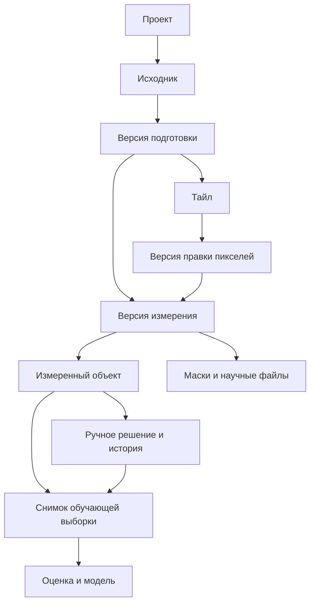

# Базы данных и развитие хранения в SoLoData

11 ноября 2026 года

Для текущей SoLoData я рекомендую **локальную SQLite для учёта данных и отдельные файлы для изображений и научных результатов**. Серверная база PostgreSQL станет уместной, когда несколько пользователей будут одновременно работать с общей коллекцией через сервер приложения. Аналитику очень больших таблиц можно позднее дополнить DuckDB и Parquet.

В приложении реализованы два разных слоя SQLite: восстанавливаемый каталог метаданных проекта и отдельная основная база ручных меток для каждой версии измерений. JSON проекта остаётся его основным документом, а актуальные ручные классы и события их изменения хранятся транзакционно. Научные изображения и CSV остаются файлами.

## Ускорение массовой разметки

При сохранении класса база `manual_object_labels.sqlite3` меняет одну метку и одновременно добавляет событие её изменения. CSV признаков и общий JSON проекта на каждом нажатии не переписываются. Проверенная таблица признаков используется повторно, пока её файловая версия не изменилась; в Windows проверяется также дополнительное поле ChangeTime, отдельно от обычного mtime. При недоступности надёжного признака версии выполняется повторная проверка содержимого. [Поле ChangeTime в документации Microsoft](https://learn.microsoft.com/en-us/windows/win32/api/winbase/ns-winbase-file_basic_info).

После первого переноса галерея и таблица без фильтров обновляют один объект. При активных фильтрах список может перестраиваться. Скрытая страница результатов получает изменённую метку без повторной загрузки CSV; графики обновляются при необходимости.

### Совместимость и сохранность

Старая JSON-разметка читается без записи. При первом сохранении все её проверенные метки переносятся в базу одной версией, а исходный файл остаётся побайтово прежним. Старые ID классов интерпретируются через их смысловые ключи. Экспорт, обучение, прогнозы и исправления масок читают актуальные метки из базы. Отмена возвращает родительскую версию целиком. Полный повторный расчёт начинает новую версию без старых меток.

Файл `manual_object_labels_storage.json` отмечает переход на основную базу. Если база исчезла или повреждена, приложение требует её восстановления и не подставляет устаревший JSON. Изменение старого JSON другой программой после переноса также останавливает назначение и экспорт до согласования копий. Для обмена со старой программой есть отдельный экспорт снимка JSON из дополнительных действий разметки.

История каждой метки записывается с ней в одной транзакции. Общий JSON получает её при следующем сохранении проекта; после сбоя недостающие события восстанавливаются из базы при открытии. В окне базы проекта видна объединённая история. Резервная копия одних метаданных не включает эти основные пользовательские данные: нужна полная копия папки проекта.

На отдельной копии существующих данных проверен перенос всех 267 ручных меток: значения сохранены полностью. Исходные JSON разметки, CSV и документ проекта остались побайтово прежними. Проверка не запускала повторную обработку изображений.

### Измерение сохранения

Ниже — синтетические таблицы, а не научные результаты. Сравнивалась предыдущая опубликованная реализация JSON из коммита `407af85` и новый вызов сохранения с кратким ответом. В каждом размере первоначально размечены 80% объектов. Приведена медиана семи чередующихся смен классов; отрисовка Qt, работа фильтров и сегментация не входят в измерение. Фоновые процессы и дисковый кеш не контролировались.

| Объектов | Прежнее сохранение JSON, мс | Новая запись SQLite, мс |
|---|---:|---:|
| 1 000 | 36,26 | 27,19 |
| 10 000 | 164,60 | 19,02 |
| 50 000 | 749,96 | 19,00 |

На 50 000 объектов операция сохранения ускорилась примерно в 39 раз. Это не обещание такого же ускорения всего интерфейса. Однократный импорт старых меток при уже загруженной таблице занял в этих запусках примерно 213, 206 и 750 мс; после него выполняются только отдельные изменения. Исходный JSON и CSV в новом варианте оставались неизменными.

Воспроизведение: `tools/benchmark_label_storage.py --output <новая-папка>`. Полные значения окончательного запуска: `data/validation/Label_storage_2026-11-11/Benchmark_002/Benchmark_results.json`.

## Что означает база данных для нашего приложения

Представьте лабораторию с изображениями и журналом. TIFF — это сами материалы исследования. В журнале записано, откуда они получены, какие варианты обработки выполнены, какие измерения к ним относятся и что исправил исследователь. База данных помогает организовать такой журнал.

**СУБД** — программа, которая управляет базой. SQLite работает внутри приложения и хранит базу в обычном файле. PostgreSQL работает как отдельная служба, к которой обращается приложение. **SQL** — язык запросов: например, «покажи подготовленные наборы для этого исходника».

Основные понятия удобно объяснить на наших данных:

| Понятие | Понятный смысл | Пример SoLoData |
|---|---|---|
| Таблица | Список однотипных записей | Исходные изображения |
| Запись | Один элемент списка | Один импортированный TIFF |
| Идентификатор | Постоянный номер записи | UUID исходника или набора |
| Связь | Указание, к какой записи относится результат | Набор подготовлен из определённого TIFF |
| Индекс | Указатель для поиска по выбранному полю | Поиск наборов по состоянию |
| Транзакция | Несколько изменений, принимаемых вместе | Обновить каталог и его отметку версии |
| Миграция | Контролируемое изменение структуры хранения | Добавить отдельный учёт версий измерений |
| Резервная копия | Независимый сохранённый экземпляр | Копия всей папки исследования на другом диске |

База не определяет, является ли выделенный объект волокном, правильно ли проведена маска и соответствует ли калибровка микроскопу. Она помогает сохранить решения и проверить связи между ними. Научная корректность остаётся отдельной задачей.

## Как SoLoData хранила данные до изменения

В исследованном исходном коде отдельной СУБД не было. Использовалось несколько согласованных файловых форматов:

| Данные | Где хранятся | Что это даёт |
|---|---|---|
| Проект, источники, наборы, настройки, история | `project.json`, модуль `src/desktop/project.py` | Читаемое описание проекта и стабильные идентификаторы |
| Оригинальные TIFF | `sources` | Локальные копии исходных байтов |
| Подготовка и тайлы | `runs`, `datasets`, `native`, `valid_masks`, `overview` | Разделение модельного холста, исходных пикселей и принадлежности |
| Импортированные полигоны | Версии в `annotations` | Сохранение исходной разметки YOLO |
| Признаки и происхождение измерений | CSV и `measurement_run.json` в `measurements` | Самостоятельные версии результатов |
| Ручные классы | `manual_object_labels.json` рядом с конкретным измерением | Отделение экспертных меток от исходных классов YOLO |
| Исключения тайлов | `tile_exclusions.json` | Причины исключений и ручной возврат |
| Редактирование изображений | `tile_edits`, `active_tile_edits.json` | Версии активных пикселей и масок |
| Задания и события | `jobs`, запросы и журналы JSON | Выполнение в отдельном процессе и диагностика |
| Обучение и прогнозы | Отдельные каталоги оценок, моделей и прогнозов | Снимки входных данных и решений |

Это уже система хранения. Отсутствие SQL само по себе не делает её неправильной. Более того, в ней есть важные научные свойства, которые необходимо сохранить.

`atomic_json` сначала пишет временный файл рядом с назначением и затем заменяет целевой файл. Читатель получает завершённую версию JSON. Это не общая транзакция для всех файлов исследования и не полная гарантия сохранности при отключении питания.

Главное окно удерживает `QLockFile`: второе окно не должно изменять тот же проект. Длительные операции выполняет рабочий процесс от имени этого окна. Проверка актуальности измерений отдельно сравнивает геометрию, разметку, активные тайлы и версии редактирования. Ручные классы связаны с конкретным измерением и хешем CSV.

Поэтому задача состоит в развитии существующего хранения с сохранением этих свойств.

### Где появляются ограничения

При сохранении проект переписывает свой JSON целиком. В частности, назначение ручного класса добавляет событие в историю проекта. Чем длиннее история, тем больше работа на одно сохранение.

`object_labels._measurement` при работе с ручными классами читает CSV, проверяет идентификаторы, строит словарь объектов и считает SHA-256. Это полезно для проверки соответствия, но повторение всей операции при каждом назначении класса может стать дорогим для больших таблиц. Для вывода о реальном времени на больших исследованиях нужен отдельный замер именно галереи объектов.

Поиск между проектами, выборки из многих версий измерений и вопросы вида «какие объекты были размечены после изменения тайла» приходится собирать на уровне Python и файлов. Единой SQL-модели этих связей пока нет. Имеющиеся проверки не следует подменять предположением, что само появление базы решает все связи.

## Какие подходы используют приложения похожего формата

Для научных приложений существуют разные разумные архитектуры. Нельзя утверждать, что любой серьёзный инструмент обязан хранить всё в серверной базе.

**QuPath** — близкий пример настольной работы с изображениями. В стандартном проекте `project.qpproj` содержит JSON-описание изображений, а данные изображений, миниатюры и классификаторы имеют отдельные места хранения. Это подтверждает применимость файлового проекта в нашем классе задач. Это пример архитектуры, а не доказательство одинаковой производительности двух программ. [Структура проектов QuPath](https://qupath.readthedocs.io/en/0.6/docs/reference/projects_structure.html).

**OMERO** показывает серверный подход. Модель данных размещается в PostgreSQL, клиенты работают через API, а оригиналы, пиксели и миниатюры находятся в отдельном двоичном репозитории. Для общей лабораторной системы такое разделение особенно показательно. [Модель и API OMERO](https://omero.readthedocs.io/en/stable/developers/GettingStarted.html), [двоичный репозиторий OMERO](https://omero.readthedocs.io/en/stable/sysadmins/unix/server-binary-repository.html).

SQLite прямо рассматривает локальные настольные приложения как подходящий сценарий. Ей не требуется постоянно работающий сервер базы. [Рекомендуемые применения SQLite](https://www.sqlite.org/whentouse.html).

Мой вывод для SoLoData: архитектуру надо выбирать по способу совместной работы и характеру запросов. Большой TIFF сам по себе не означает необходимости PostgreSQL.

## Сравнение вариантов

Оценки применимости в последнем столбце — моё инженерное заключение для текущей SoLoData. Это не результаты сравнительного тестирования всех перечисленных СУБД.

| Вариант | Для чего подходит | Ограничение в нашей ситуации | Решение |
|---|---|---|---|
| JSON и CSV с каталогами файлов | Небольшие локальные исследования, обмен результатами | Связи и поиск реализуются вручную; растёт цена перечитывания | Сохранить совместимость и научные файлы |
| SQLite | Локальный учёт, связанные записи, небольшие частые изменения | Единственный активный SQL-писатель; не сервер совместной работы | Основной выбор для локального развития |
| DuckDB | Аналитические выборки и сводки по большим таблицам | Встроенный режим имеет особые ограничения записи из разных процессов | Возможное дополнение для аналитики |
| PostgreSQL | Общий сервер, несколько пользователей, централизованные права | Нужны сервер, обновления, обслуживание и серверные резервные копии | Следующий уровень при совместной работе |
| MySQL или SQL Server | Другие варианты серверной реляционной архитектуры | Сейчас не дают основания добавлять серверную инфраструктуру | Рассматривать при требовании организации |
| MongoDB | Документы с гибкой структурой и вложенными полями | В нашем предметном мире много устойчивых связей и версий | Сейчас не выбирать основной базой |
| Redis, графовая или векторная база | Кеширование, графовые задачи или поиск похожих представлений | Эти задачи не являются основой текущего хранения | Добавлять только под конкретную функцию |
| HDF5, Zarr, OME-Zarr | Многомерные массивы изображений | Это иной слой хранения, а не замена учёта проектов и решений | Рассматривать отдельно при развитии просмотра |
| Parquet | Компактные типизированные таблицы для аналитики | Файловый формат не заменяет базу частых пользовательских изменений | Возможный экспорт больших таблиц |

PostgreSQL использует клиент-серверную архитектуру: клиент и сервер могут находиться на разных компьютерах. Для будущей общей лаборатории я предпочёл бы её как серверную основу, но это выбор для иной организации приложения. [Архитектура PostgreSQL](https://www.postgresql.org/docs/current/tutorial-arch.html).

MongoDB позволяет хранить документы разной структуры и связывать данные через вложение или ссылки. Это реальная возможность, но гибкость документа сама по себе не упрощает наши связи «исходник → подготовка → измерение → объект → ручное решение». [Моделирование данных MongoDB](https://www.mongodb.com/docs/manual/data-modeling/).

DuckDB интересна для чтения больших таблиц и вычисления сводок. В её встроенном режиме несколько потоков записи внутри процесса и запись из нескольких отдельных процессов — разные сценарии. Поэтому перед интеграцией нужно отдельно спроектировать взаимодействие Qt и рабочих процессов. Применимость серверных расширений также следует проверять для выбранной версии. [Модель конкурентного доступа DuckDB](https://duckdb.org/docs/stable/connect/concurrency).

Parquet хранит данные по столбцам и использует сжатие и кодирование. Его можно использовать для выгрузок признаков; запись одного ручного решения удобнее организовать в транзакционной базе. [Обзор Apache Parquet](https://parquet.apache.org/docs/overview/).

Zarr разбивает массивы на части, которые можно хранить и читать отдельно. Это важно для будущих больших стеков и многоуровневого просмотра, но не заменяет журнал версий объектов. Переход потребует проверки осей, единиц, каналов и точного соответствия пикселей. [Спецификация Zarr](https://zarr-specs.readthedocs.io/en/latest/v3/core/index.html).

## Почему выбран SQLite вместе с файлами

Текущее приложение работает локально, без интернета, использует Python и уже ограничивает изменение одного проекта одним главным окном. SQLite соответствует этому режиму и доступна через стандартный модуль Python `sqlite3`; отдельная новая библиотека базы не добавлена. В проверенном научном окружении установлены Python 3.10.19 и SQLite 3.50.2. [Интерфейс sqlite3 в Python](https://docs.python.org/3.10/library/sqlite3.html).

В SQLite имеет смысл хранить небольшие связанные записи: идентификаторы, состояния, параметры, ссылки на файлы и историю решений. Большие TIFF и маски сохраняют самостоятельную научную ценность и удобство работы с существующими инструментами. Перенос их внутрь SQL сейчас усложнил бы копирование и обслуживание без установленной необходимости.

Самое важное решение первого этапа — **один явный источник истины**. Им остаётся `project.json`. SQLite является производным каталогом, который можно построить заново. Нельзя одновременно считать независимо редактируемые JSON и SQL главными: при несовпадении пришлось бы угадывать, какая запись правильная.

Отдельный перенос ручных меток на SQL выполнен с обновлением назначения класса, экспорта, коррекций масок и отмены. Каталог проекта и база меток имеют разное назначение: первый можно пересоздать, вторую необходимо сохранять в резервных копиях.

## Что уже внедрено

### Файл базы и его состав

Рядом с `project.json` создаётся `project.sqlite3`. Для совместимого проекта с иным именем JSON имя каталога образуется от того же имени. Новые проекты получают каталог при создании; существующие — при следующем успешном сохранении или по кнопке обновления. Простое чтение старого проекта не меняет его файлы.

| Таблица SQLite | Содержимое |
|---|---|
| `snapshot` | SHA-256, точные байты сохранённого JSON и время индексирования |
| `sources` | Идентификаторы, имена, пути и полные записи исходников |
| `datasets` | Идентификаторы, связь с источником, имя, состояние, путь и полные записи наборов |
| `history` | События в исходном порядке, время, действие, ссылка на набор и полная запись события |

Необязательные и расширенные поля сохраняются внутри записей JSON. Старые записи без UUID допускаются: порядковая позиция остаётся техническим ключом строки каталога. Для поиска созданы SQL-индексы по идентификаторам, состоянию набора, исходнику и действию истории.

Каталог не сканирует TIFF и не пересчитывает изображения. Он не переносит в SQL геометрию тайлов, отдельные объекты, признаки или ручные классы. Списки в основной рабочей области продолжают использовать существующий механизм; SQL-просмотр добавлен в отдельное окно каталога.

### Порядок сохранения и восстановление

Сохранение выполняется в таком порядке:

1. Приложение проверяет рабочие настройки существующими правилами.
2. Публикует `project.json` прежним атомарным способом.
3. Обновляет SQLite одной транзакцией. Неизменённые строки каталога сохраняются; обычное дополнение истории добавляет новые строки.
4. Записывает в каталоге точный снимок и хеш JSON.

Это две последовательные публикации, а не одна общая транзакция JSON и SQL. Если между ними произошёл сбой, JSON остаётся главным. SQL-запрос проверяет хеш и отказывается показывать устаревшую версию. Обновление каталога исправляет несоответствие.

Сбой SQLite не превращает уже сохранённый проект в несохранённый: причина записывается в диагностический журнал. Повреждённый каталог не подменяет JSON. Явная команда пересоздания сохраняет прежние байты базы и найденных служебных файлов в `backups/Database_catalog_001`, затем публикует новый индекс. Неизвестная схема или база с чужим идентификатором приложения не заменяется.

Проверяется структура SQLite командой `integrity_check`. Это проверка файла базы, а не качества сегментации. В этой версии каталог не задаёт SQL-внешних ключей между наследуемыми идентификаторами: неполные старые записи сохраняются без выдуманных связей. Проверки происхождения научных файлов остаются в прежних модулях. Возможности и ограничения SQLite-проверок описаны в [документации PRAGMA](https://www.sqlite.org/pragma.html).

Соединения короткие, отдельные для каждого обращения. Между Qt и рабочим процессом не передаётся общий объект соединения. Новая база использует обычный rollback journal и `synchronous=FULL`; WAL автоматически не включён. WAL допускает одновременное чтение и запись, но сохраняет ограничение одного писателя и требует общей памяти на одном компьютере. Сейчас его преимущества не оправдывают дополнительные постоянно сопутствующие файлы. [Описание WAL](https://www.sqlite.org/wal.html).

### Управление из приложения

Откройте **«Справка → База данных проекта…»**.

- Состояние каталога показывает, совпадает ли он с сохранённым проектом и проходит ли проверка базы.
- «Сохранённые наборы» и «Сохранённая история» показывают по 100 строк; страницы переключаются кнопками. История также включает уже зафиксированные изменения меток, даже если очередной снимок `project.json` ещё не сохранён.
- «Обновить каталог» создаёт отсутствующую базу или обновляет устаревшую.
- «Пересоздать каталог» служит для восстановления повреждённого индекса с сохранением предыдущего.
- «Копия метаданных проекта…» создаёт новую папку резервной копии метаданных.
- F1 и кнопка справки открывают пояснения.

Окно недоступно во время вычислительной задачи. Оно показывает сохранённые значения; незавершённый черновик настроек не индексируется.

Состояние «каталог актуален» **не означает**, что все изображения существуют, маски верны или результаты можно использовать для обучения. Действующие проверки актуальности измерений выполняются отдельно, как раньше.

Для трёх найденных локальных проектов каталог уже создан отдельно, с проверкой неизменности байтов каждого `project.json`:

| Проект | Исходников | Наборов | Событий истории |
|---|---:|---:|---:|
| `default` | 0 | 0 | 0 |
| `ForGif` | 3 | 0 | 2 |
| `Test` | 1 | 1 | 492 |

Это состояние на момент внедрения, а не автоматический поиск всех возможных проектов на компьютере. Результат проверки сохранён в `data/validation/database_2026_11_11/existing_projects.json`.

### Что вам сделать сейчас

Запустите обновлённое приложение обычным способом и откройте «Справка → База данных проекта…». Для этих проектов каталог должен быть актуален; для старого проекта из другого места можно нажать «Обновить каталог». Вручную открывать и редактировать SQLite не требуется.

Продолжайте работать с изображениями и разметкой привычным способом. Перед важным исследованием сделайте полную резервную копию папки на независимом диске. Сервер базы и платная облачная услуга для этого этапа не нужны.

## Замер каталога метаданных на первом этапе

Выполнен воспроизводимый **синтетический** эксперимент на метаданных. Он не использует реальные изображения, не измеряет качество распознавания и не сравнивает скорость обработки TIFF. Для каждого размера создавались отдельные источники, наборы и события истории.

Запрос в обоих вариантах выбирает первые 100 наборов со статусом `ready`: один вариант заново читает и разбирает JSON, второй читает SQLite и проверяет SHA-256 JSON. Приведена медиана семи повторов. Время первого индексирования измерено один раз. Это локальный ориентир в среде разработки; фоновые процессы и состояние дискового кеша не контролировались.

| Наборов / событий истории | Запрос через чтение JSON, мс | Запрос через SQLite, мс | Сохранение только JSON, мс | Сохранение JSON и каталога, мс |
|---|---:|---:|---:|---:|
| 10 / 100 | 0,32 | 1,76 | 4,25 | 21,03 |
| 100 / 10 000 | 19,08 | 6,27 | 77,35 | 151,91 |
| 1 000 / 50 000 | 69,65 | 23,16 | 377,33 | 771,08 |

Первое индексирование заняло соответственно около 20, 240 и 1 032 мс. В последнем примере JSON занимал около 8,1 МБ, SQLite — 28,7 МБ. Каталог содержит как исходный снимок JSON, так и отдельные записи и индексы; поэтому он увеличивает общий размер метаданных.

Измерение показывает реальный компромисс. При маленьком проекте SQL-запрос дороже простого чтения JSON. Для длинной истории выборка через каталог сокращает время получения страницы, но сопровождение двух форматов увеличивает время сохранения. Сохранение с каталогом добавляло семь событий за семь повторов; различие размеров между повторами мало относительно исходного объёма.

Это не ускорение всего приложения: сравнение не включает уже загруженный в память список Python, а обычные списки основного окна на SQL не переведены. Фильтры и сегментация от появления базы быстрее не становятся.

Вывод первого этапа: каталог полезен для структурированного учёта, диагностики и отдельного постраничного просмотра. Новое сохранение меток уже использует основное транзакционное хранилище и не обновляет этот каталог на каждом нажатии; его отдельный замер приведён выше. Остальные операции по-прежнему сохраняют общий JSON. Дальнейшее расширение потребует отдельной миграции остальных часто изменяемых записей: бесконечно наращивать главный JSON и его снимок неэффективно.

Скрипт: `tools/benchmark_project_catalog.py`. Результаты этого запуска: `data/validation/database_2026_11_11/benchmark_01/benchmark.json`.

## Как правильно делать резервную копию

Здесь есть два разных действия.

**Копия метаданных из нового окна** содержит согласованные `project.json` и `project.sqlite3` и файл `METADATA_ONLY.txt`. Копия SQLite создаётся через Backup API и проверяется. Существующая папка назначения не перезаписывается. При незавершённой операции остаётся отметка `INCOMPLETE.txt`. Механизм резервного копирования SQLite позволяет получить согласованный снимок базы. [SQLite Backup API](https://www.sqlite.org/backup.html).

Этой копии недостаточно для восстановления всего исследования: в ней нет изображений, масок, разметки, классов объектов, CSV измерений и моделей.

**Полная резервная копия исследования** делается следующим образом:

1. Дождитесь окончания операции или штатно остановите задание.
2. Закройте все окна SoLoData, работающие с проектом.
3. Скопируйте всю папку проекта на другой диск, включая исходники, результаты и служебные файлы.
4. Храните несколько датированных копий; хотя бы одна должна быть независима от рабочего диска.
5. Проверяйте восстановление на отдельном экземпляре: наличие TIFF, открытие native-тайла и маски, соответствие CSV и ручных классов.

Само копирование папки ещё не гарантирует переносимость на другой компьютер. В существующих проектах встречаются абсолютные пути. Автоматический перенос всех ссылок в этой работе не внедрён; при восстановлении в другом месте понадобится отдельная проверка путей. Исторические сведения об исходных путях нельзя массово переписывать как текущие.

Резервная копия на том же диске защищает от некоторых ошибочных изменений, но не от поломки диска. SQLite также не является встроенным шифрованием или системой разграничения доступа.

## Как расширять систему дальше

### Большие локальные проекты

Ручные решения и их события уже перенесены в отдельное транзакционное SQLite-хранилище; JSON доступен как явный экспорт совместимости. Следующий приоритет для ещё более крупных проектов — измерять полный сценарий с фильтрами и добавлять постраничную загрузку объектов, чтобы сократить память интерфейса.

Предлагаемая будущая модель:



Эта схема — направление расширения, а не описание уже созданных таблиц.

Идентичность объекта должна включать проект или набор, версию измерения, тайл и локальный `Object_ID`. Одного номера 17 недостаточно: после пересчёта объект 17 может иметь другую маску. Исходный класс YOLO, ручной класс и прогноз модели должны храниться отдельно.

Переход сопровождается регрессиями сохранения класса, массовых исправлений масок, удаления всех объектов, отмены, экспорта и открытия старых версий. Метки неизменённых объектов должны сохраняться, а новые объекты требовать проверки. Автоматический перенос класса на новый ID недопустим.

### Аналитика многих измерений

При необходимости объединять крупные таблицы можно добавить выгрузку Parquet и запросы DuckDB. Это отдельный аналитический слой: хранение точных масок и цепочки происхождения остаётся обязательным.

В запросах нельзя складывать `Area` и `Area_um2` как одну величину. Для физической площади нужен сохранённый масштаб конкретного измерения. При размере пикселя 0,4 мкм и `Area=100` физическая площадь равна `100 × 0,4² = 16 мкм²`. Позднее обнаружение метаданных TIFF не должно менять историческое измерение задним числом.

Снимок обучения должен фиксировать версии измерений и ручных решений. Группы исходников или экспериментов должны оставаться целыми при разделении данных. Идентификаторы, цели и исходные классы не должны случайно становиться признаками модели. База должна облегчать эти проверки, а не скрывать их.

### Общая лаборатория

Когда несколько человек должны одновременно менять общую коллекцию, рекомендую **сервер приложения с PostgreSQL и отдельным файловым или объектным хранилищем изображений**.

Настольные клиенты обращаются к API. Сервер проверяет пользователя, права, версии записей и конфликты, затем согласует задания и сохранение. Клиентам не нужно напрямую открывать общий файл SQLite. Потребуются учётные записи, журнал авторства, резервные копии базы вместе с файлами и проверенная политика восстановления.

Просто положить `project.sqlite3` на сетевой диск недостаточно. SQLite предупреждает о проблемах сетевых блокировок и рекомендует клиент-серверный вариант для соответствующих сценариев. Аналогично, синхронизация рабочего проекта через облачный диск не разрешает конфликт одновременных изменений. [Границы применения SQLite](https://www.sqlite.org/whentouse.html).

Не стоит включать двустороннюю синхронизацию «локальная SQLite ↔ PostgreSQL» без отдельного проекта синхронизации: офлайн-изменения, удаление, версии масок и конфликты меток требуют явных правил.

## Когда переходить к следующему этапу

Размер коллекции в гигабайтах — слабый критерий выбора базы. Миллион небольших часто меняющихся записей и один очень большой TIFF предъявляют разные требования.

| Наблюдаемый признак | Следующее действие |
|---|---|
| Назначение класса начинает заметно задерживать работу | Основная SQLite для меток уже внедрена; измерить стоимость активных фильтров и отрисовки |
| Галерея и таблицы требуют слишком много памяти | Добавить запросы объектов по страницам и выборочные загрузки |
| Нужны сводки многих измерений | Проверить Parquet/DuckDB на реальном запросе |
| Несколько сотрудников одновременно изменяют общие данные | Проектировать API, PostgreSQL, авторство и конфликты |
| Большие стеки неудобно просматривать | Исследовать многомасштабное хранение изображений и OME-Zarr |
| Проекты регулярно переносят между компьютерами | Внедрять управляемые относительные ссылки и проверяемое восстановление |

Для рабочего контроля можно принять пользовательский ориентир: обычное назначение класса желательно укладывать примерно в 100 мс, а открытие страницы — в заметно меньше секунды. Это предлагаемые цели удобства, а не измеренные гарантии текущего приложения и не пределы SQLite.

## Проверка внедрения

Отдельные проверки покрывают точный снимок JSON, порядок записей, фильтры и страницы SQL, запрет выдачи устаревших данных, откат транзакции, сохранение JSON при отказе SQLite, открытие старого проекта, защиту неизвестной схемы, восстановление повреждённого каталога и резервную копию без перезаписи назначения.

Проверки интерфейса покрывают просмотр сохранённых значений вместо черновика, переключение страниц, создание отсутствующего каталога, блокировку обслуживания во время задачи и содержание справки. Отдельно просмотрены изображения нового окна и справки.

Первый запуск тестов встретил отказ доступа к стандартной временной папке Windows sandbox. Для проверки задан `tempfile.tempdir` в отдельном каталоге `data/validation/database_2026_11_11/tmp`. Это обход ограничения среды, не исправление научного кода.

Штатный запуск `launch_app.ps1 -SmokeTest` на отдельном тестовом проекте завершился успешно, код выхода 0. Научная валидация относительно экспертных масок этим тестированием не заменяется.

После ускорения разметки проверены все 382 уникальных регрессионных теста, включая 16 проверок основной базы меток и 3 проверки точечного обновления интерфейса. Проверки охватывают неизменность старого JSON, неверные схемы, два писателя, откат при ошибке, принудительное завершение процесса посреди транзакции, восстановление истории и изменение CSV между чтением и записью. Последний целевой прогон: 39 тестов, все пройдены. Все 382 теста имеют успешный результат в объединённом покрытии нескольких запусков; общий Qt-процесс завершился раньше конца, оставшиеся модули успешно проверены отдельным запуском. Сводка: `data/validation/Label_storage_2026-11-11/Coverage_results.json`.

В Windows sandbox используется доступная временная папка, ограничено число вычислительных потоков и научные библиотеки загружены до Qt. Это особенности запуска проверки, а не новые настройки проекта. Прежняя проверка 363 тестов и актуализация старых ожиданий контрольных файлов относятся к первому этапу публикации; её сводка — `data/validation/database_2026_11_11/release_validation.json`.

## Файлы реализации и воспроизведение

| Файл | Назначение |
|---|---|
| `src/desktop/project_catalog.py` | Каталог SQLite, проверка, выборки, резервная копия и пересоздание |
| `src/desktop/project.py` | Обновление каталога после успешного сохранения JSON |
| `src/desktop/database_dialog.py` | Окно проверки и обслуживания каталога |
| `src/desktop/main_window.py` | Пункт меню и блокировка обслуживания |
| `src/desktop/help_center.py` | Руководство приложения |
| `tools/project_database.py` | Диагностика и обслуживание с блокировкой проекта |
| `tools/benchmark_project_catalog.py` | Синтетический эксперимент |
| `test/test_project_catalog.py`, `test/test_database_ui.py` | Новые проверки хранения и интерфейса |
| `src/desktop/label_database.py`, `src/desktop/file_revision.py` | Основное транзакционное хранение меток, аудит и проверка неизменности CSV |
| `test/test_label_database.py`, `test/test_incremental_label_ui.py` | Совместимость, аварийный откат и точечное обновление интерфейса |
| `tools/benchmark_label_storage.py` | Сравнение сохранения меток с предыдущей опубликованной реализацией |

Примеры для разработчика из корня проекта:

Команда `list history` ниже читает последний снимок JSON/каталога. События меток, записанные после него, уже сохранены в базах измерений и видны в приложении; в каталог они попадут при очередном сохранении проекта.

```powershell
$python = ".venv\Scripts\python.exe"
& $python -B tools/project_database.py --project '<папка>\project.json' status
& $python -B tools/project_database.py --project '<папка>\project.json' sync
& $python -B tools/project_database.py --project '<папка>\project.json' list datasets --status ready
& $python -B tools/project_database.py --project '<папка>\project.json' list history --action assign_object_class --limit 100
& $python -B tools/project_database.py --project '<папка>\project.json' backup '<новая-папка-копии>'
& $python -B tools/benchmark_project_catalog.py --output '<новая-папка-эксперимента>'
```

`status` и `list` читают данные. `sync`, `rebuild` и `backup` требуют закрыть проект в приложении и используют ту же блокировку, что главное окно. Обычному пользователю достаточно нового окна в меню «Справка».
